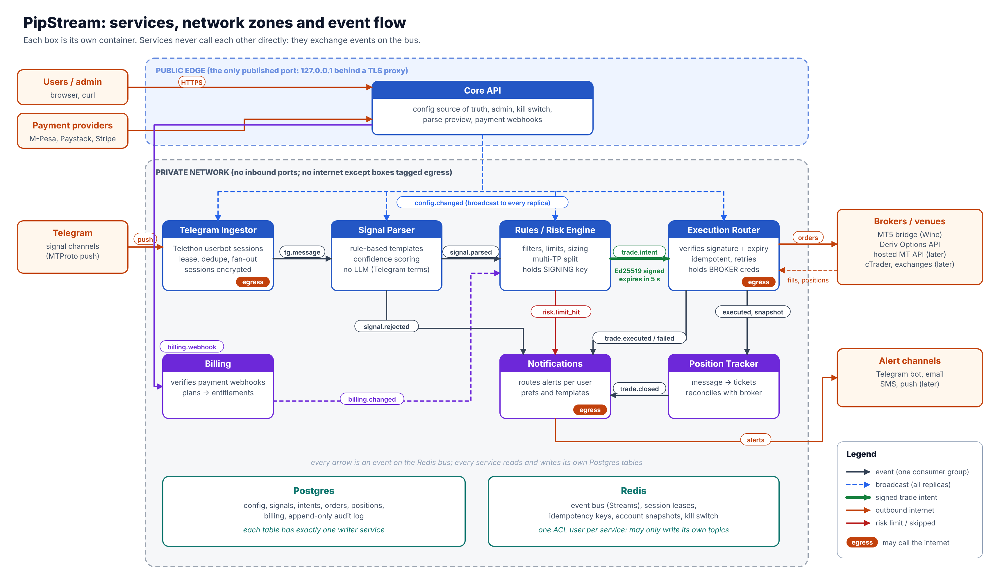
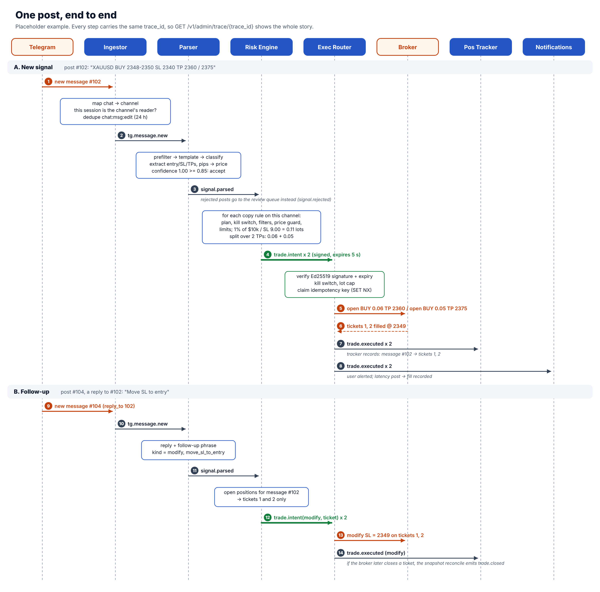
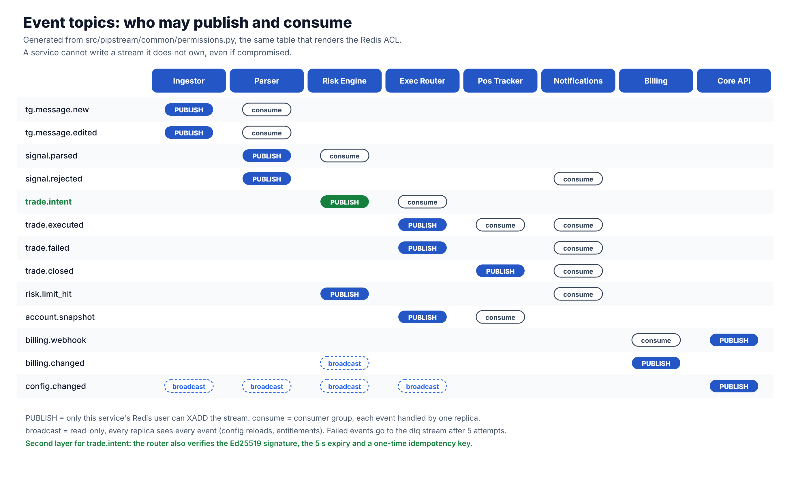
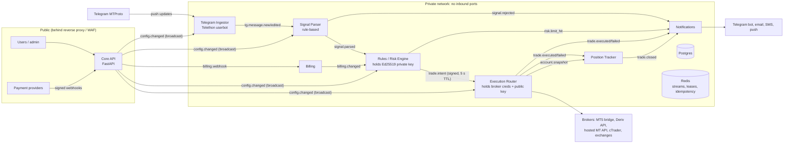

# PipStream architecture

Event-driven services on a message bus (Redis Streams for the experiment, NATS JetStream
later behind the same `Bus` API). Every service is a separate container built from one
image; they share **contracts** (`src/pipstream/common/events.py`), never code paths.







The images above are generated by `python docs/diagrams/build.py` (SVG sources sit next to
them; the topic matrix is built from `permissions.py`). The Mermaid versions below render
on GitHub too.

## 1. System view



## 2. One post, end to end

```mermaid
sequenceDiagram
  autonumber
  participant TG as Telegram
  participant ING as Ingestor
  participant PAR as Parser
  participant RISK as Risk Engine
  participant RT as Router
  participant BRK as Broker
  participant TRK as Tracker
  participant N as Notifications

  TG->>ING: "XAUUSD BUY 2348-2350 SL 2340 TP 2360 / 2375"
  ING->>ING: map chat -> channel, check reader assignment,<br/>dedupe chat:msg:edit (24 h)
  ING->>PAR: tg.message.new (trace_id)
  PAR->>PAR: prefilter -> templates -> classify -> extract -> validate -> confidence
  PAR->>RISK: signal.parsed (stored in signals)
  loop each enabled copy rule on the channel
    RISK->>RISK: entitlement, kill switch, filters, price guard,<br/>limits, sizing, multi-TP split
    RISK->>RT: trade.intent x N legs (Ed25519, expires in 5 s)
  end
  RT->>RT: verify signature, expiry, kill switch, lot cap,<br/>claim idempotency key
  RT->>BRK: open (decrypt creds in memory)
  BRK-->>RT: ticket, fill
  RT->>TRK: trade.executed
  RT->>N: trade.executed
  TRK->>TRK: positions: (account, channel, message 102, TP leg) -> ticket
  Note over TG,TRK: later, reply to 102: "Move SL to entry"
  TG->>ING: reply_to_id = 102
  ING->>PAR: tg.message.new
  PAR->>RISK: signal.parsed (kind=modify, move_sl_to_entry)
  RISK->>RISK: look up open tickets for message 102
  RISK->>RT: trade.intent(modify, ticket) per leg
  RT->>BRK: modify SL = open price
```

## 3. Bus topics and who may use them

Source of truth: `src/pipstream/common/permissions.py`. The same table drives the client-side
publish guard and the generated **Redis ACL file**, so a compromised service cannot write a
stream it does not own (tested in `tests/test_bus_acl.py`).

| Topic | Producer (only) | Consumers | Delivery |
|---|---|---|---|
| `tg.message.new`, `tg.message.edited` | ingestor | parser | group (one replica) |
| `signal.parsed` | parser | risk_engine | group |
| `signal.rejected` | parser | notifications (review queue) | group |
| `trade.intent` | **risk_engine** | execution_router | group |
| `risk.limit_hit` | risk_engine | notifications | group |
| `trade.executed`, `trade.failed` | execution_router | position_tracker, notifications | group per service |
| `account.snapshot` | execution_router | position_tracker | group |
| `trade.closed` | position_tracker | notifications | group |
| `billing.webhook` | core_api | billing | group |
| `billing.changed` | billing | risk_engine | broadcast |
| `config.changed` | core_api | ingestor, parser, risk_engine, execution_router | broadcast (every replica) |
| `user.command` (close all, approve/skip a held signal) | core_api (web app, PipStream bot) | risk_engine | group |
| `dlq` | any (failed after 5 deliveries) | operators | – |

Every event is an envelope `{event_id, topic, trace_id, occurred_at, producer, payload}`.
Delivery is at-least-once, so every handler is idempotent:

- ingestor: dedupe key `chat:message:edit_version`
- parser: `signals` unique on `(channel, message, edit_version)`; re-delivery re-publishes the same `signal_id`
- risk engine: `trade_intents.idempotency_key = signal:rule:action:leg|ticket` (unique)
- router: `SET NX ps:idem:<key>` before calling the broker
- tracker: `positions` unique on `(account, ticket)`

## 4. Data ownership

One Postgres for the experiment; each table has one writer.

| Writer | Tables |
|---|---|
| core_api (and `pipstream seed`) | users, telegram_accounts, channels, channel_readers, subscriptions, parser_profiles, connectors, broker_accounts, copy_rules, plans, notification_prefs |
| parser | signals |
| risk_engine | trade_intents, shadow_trades |
| execution_router | orders (and disables a broker account on auth failure) |
| position_tracker | positions |
| billing | billing_subscriptions, invoices |
| everyone | audit_log (append-only, enforced by trigger) |

Row-level security policies by `user_id` are defined for user-scoped tables; workers connect
as the schema owner, user-facing queries will use a non-owner role with `app.user_id` set.

## 5. Security (anti-hijack)

| Threat | Control |
|---|---|
| Someone injects or replays a trade | Only risk engine can XADD `trade.intent` (Redis ACL). Router verifies the Ed25519 signature (private key only in risk engine), 5 s expiry and a one-time idempotency key. Forged intents are audited and dropped. |
| Leaked broker creds / Telegram sessions | Encrypted at rest (`SecretBox`, rotatable keys; swap for KMS later); decrypted only in router / ingestor, in memory; redacted from logs; write-only through the API. |
| Session used twice (Telegram bans) | Redis lease per session with compare-and-renew; lost lease = disconnect. |
| Service reachable from the internet | Only core-api publishes a port (127.0.0.1). Workers sit on an `internal: true` network; ingestor, router and notifications also join `egress` for outbound calls only. |
| Container escape / tampering | Non-root user, read-only root FS, `cap_drop: ALL`, `no-new-privileges`. |
| Runaway trading | Global and per-user kill switch (checked in risk engine and router), router-wide lot cap, per-rule max lot / open trades / daily loss, confidence threshold, shadow + paper modes. |
| Secret sprawl | Each container gets only its own env vars (signing key: risk engine; verify key + master key: router; bot token: notifications). |

## 6. Telegram ingestion

- One Telethon client per linked account (spare account for the experiment), read-only.
- Sessions sharded across ingestor replicas by rendezvous hashing (`PS_INGESTOR_SHARD/SHARDS`).
- `channel_readers` gives each channel an active and standby reader: a channel is read once
  and fanned out to every subscriber's rules; if the active reader's lease disappears, a
  standby's posts are used instead.
- `PS_INGESTOR_SOURCE=replay` plays `config/replay/*.jsonl` for demos and tests.

## 7. Parsing (rule-based, no LLM)

`services/parser/engine.py`. Per-channel `parser_profiles.config` can add symbol aliases,
buy/sell words, ignore patterns (promo posts) and exact regex templates. Generic extractor
handles ranges (`2348-50`), pending orders, pips (`SL 30 pips` -> price using the symbol's
pip size), multiple TPs, thousands separators, `XAU/USD`. Confidence drops for missing SL,
SL/TP on the wrong side, several symbols, long commentary; below `min_confidence` the post
is rejected into the review queue. Follow-ups (`move SL to entry`, `close half`, `close
30%`, `new SL 2345`) are trusted only as replies unless the profile says otherwise.
Deriv options (`V75 RISE 5 ticks stake $2`) become `kind=options`.

Use `POST /v1/admin/parse-preview` to try a profile against a post before saving it.

## 8. Execution connectors

```python
class Connector(Protocol):
    name: str
    async def connect(self, creds) -> None
    async def open(self, intent: TradeIntent) -> OrderResult
    async def modify(self, ticket, sl, tp) -> OrderResult
    async def close(self, ticket, volume=None) -> OrderResult
    async def positions(self) -> list[Position]
    async def account_info(self, symbols=None) -> AccountInfo
    async def health(self) -> Health
    async def disconnect(self) -> None
```

| Connector | Status | Notes |
|---|---|---|
| `paper` | working | state in Redis; fills at intent/reference price; no SL/TP or option-expiry simulation yet |
| `mt5_bridge` | implemented, tested against a fake | official `MetaTrader5` API over rpyc to a Wine/Docker bridge; magic number filters out the user's manual trades. **Verify the bridge image.** |
| `deriv_options` | implemented, tested against a fake | Deriv WebSocket JSON API (authorize/proposal/buy/sell/portfolio). **Verify against Deriv's current Options API** (OTP WebSocket flow in the handoff). |
| hosted MT API (MetaApi / MetaRPC), cTrader, exchanges, webhook | planned | same protocol |

Errors: `RetryableError` (network, requote) is retried only while the intent is valid;
`AuthError` disables the account; `ConnectorError` fails the trade.

## 9. Moving past the experiment

- Bus: swap `Bus` internals for NATS JetStream with per-service accounts (same topic table).
- Secrets: replace `SecretBox` with a KMS/Vault envelope implementation.
- Postgres: per-service roles with grants matching section 4.
- Web app (Next.js) talks only to Core API; Telegram login flow moves from the CLI to an
  internal RPC between Core API and the ingestor.
- Observability: OpenTelemetry spans keyed by `trace_id`; metrics on post -> order latency,
  parse/reject rate per channel, connector failures, sessions connected, bus lag.
